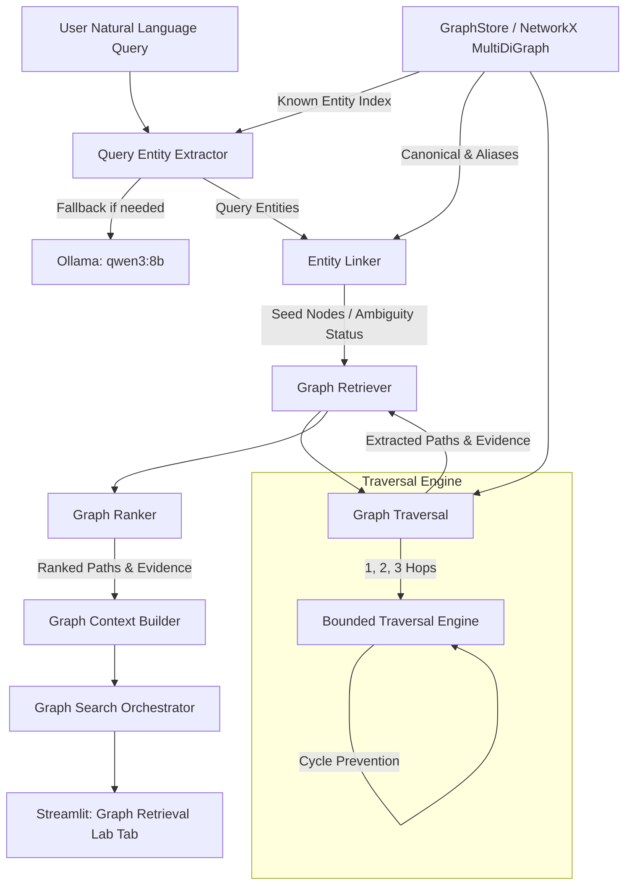

# Phase 5 Initial Audit: Architecture, Baseline & Preservation Scope

**Project:** Graph RAG Benchmark  
**Phase:** Phase 5 — Graph Retrieval & Multi-Hop Reasoning  
**Audit Date:** 2026-11-13  
**Status:** **AUDIT COMPLETE — BASELINE VERIFIED & PRESERVED**

---

## 1. Project Context & Objectives

The **Graph RAG Benchmark** project is systematically constructing, benchmarking, and comparing three distinct retrieval-augmented generation paradigms:
1. **Vector RAG (Phase 3):** Dense embedding retrieval via ChromaDB.
2. **Graph RAG (Phase 4 & 5):** Knowledge Graph construction and multi-hop relational retrieval.
3. **Hybrid RAG (Phase 6):** Reciprocal Rank Fusion (RRF) combining vector and graph retrieval.
4. **Evaluation & Benchmarking (Phase 7):** Automated LLM evaluation across MRR, NDCG, faithfulness, and answer relevance.

We are entering **Phase 5: Graph Retrieval & Multi-Hop Reasoning**. The objective of this phase is to build a high-performance, deterministic, and explainable Graph Retrieval Engine that navigates the Phase 4 Knowledge Graph using 1-hop, 2-hop, and 3-hop traversals, extracts relationship evidence with exact source provenance, deterministically ranks paths, and packages structured graph context.

---

## 2. Inventory of Existing Codebase Modules

All existing modules across Phases 1 through 4 have been audited and verified:

### Phase 1: Foundation, Health & Ollama Client
- `src/graphrag_bench/config.py`: Pydantic V2 `Settings` managing environment variables, directories, and model hyperparameters.
- `src/graphrag_bench/logger.py`: Thread-safe structured logging with console and file handlers.
- `src/graphrag_bench/ollama_client.py`: Robust HTTP REST client for Ollama API (`/api/generate`, `/api/embed`, `/api/tags`, `think: false`).
- `src/graphrag_bench/health.py`: Diagnostics checking Python version, dependencies, Ollama connectivity, and models.

### Phase 2: Document Ingestion & Chunking
- `src/graphrag_bench/schemas.py`: Pydantic models `DocumentMetadata`, `DocumentChunk`, `DocumentInfo`.
- `src/graphrag_bench/document_validator.py`: Security validation, extension filtering, null-byte and path-traversal sanitization.
- `src/graphrag_bench/document_loader.py`: Text extractors for PDF (pypdf), DOCX (python-docx), TXT, and Markdown.
- `src/graphrag_bench/text_cleaner.py`: Unicode NFKC normalization, control-character stripping, newline normalization.
- `src/graphrag_bench/chunking.py`: Sliding-window word chunker with exact character offsets.
- `src/graphrag_bench/document_processor.py`: End-to-end ingestion pipeline coordinator.
- `src/graphrag_bench/document_repository.py`: Atomic storage in `data/processed/` with manifest synchronization.

### Phase 3: Embeddings & Vector Search
- `src/graphrag_bench/embedding_service.py`: Vector embeddings via `nomic-embed-text` with batching and normalization.
- `src/graphrag_bench/vector_store.py`: ChromaDB client (`hnsw:space = cosine`) with raw cosine similarity and normalized scores.
- `src/graphrag_bench/indexing_pipeline.py`: Incremental document chunk indexing pipeline.
- `src/graphrag_bench/semantic_search.py`: Nearest-neighbor semantic retrieval with metadata filtering.

### Phase 4: Knowledge Graph Construction
- `src/graphrag_bench/graph_schemas.py`: Data models for entities, relationships, chunk extractions, and 11 standard taxonomies.
- `src/graphrag_bench/graph_extraction_service.py`: LLM extraction with verbatim quote grounding and markdown normalization.
- `src/graphrag_bench/entity_resolver.py`: Deterministic entity IDs (`ent_<type>_<sha256[:12]>`), type isolation, and alias registry.
- `src/graphrag_bench/graph_store.py`: NetworkX `MultiDiGraph` wrapper with topological analytics, ego-subgraphs, and JSON/GraphML serialization.
- `src/graphrag_bench/graph_builder.py`: Incremental graph construction coordinator with manifest tracking.

---

## 3. Persistent Data State & Immutability Rules

The following files and directories constitute canonical state and are **strictly immutable (read-only)** during Phase 5 retrieval development:

| Path | Purpose | Current Verified State |
|---|---|---|
| `data/processed/documents.json` | Canonical ingested document metadata | 3 documents (`.docx`, `.md`, `.txt`) |
| `data/processed/chunks.jsonl` | Canonical document chunks | 3 chunks with exact character spans |
| `data/chroma/chroma.sqlite3` | ChromaDB vector collection | `graphrag_documents` with 3 indexed vectors |
| `data/knowledge_graph/knowledge_graph.json` | Canonical Knowledge Graph (JSON) | 22 entities, 20 grounded relationships |
| `data/knowledge_graph/knowledge_graph.graphml` | Portable Knowledge Graph (GraphML) | 22 nodes, 20 edges (NetworkX compatible) |
| `data/knowledge_graph/manifest.json` | Construction manifest | 3/3 chunks processed, 0 failed, 0 pending |
| `data/knowledge_graph/extractions.jsonl` | Append-only extraction audit trail | Full logs including rejection reasons |

---

## 4. Phase 5 Architecture Blueprint

### Components to Implement:
1. `src/graphrag_bench/config.py`: Add `graph_max_hops`, `graph_max_results`, `graph_max_paths`, `graph_traversal_direction`, `graph_max_degree`.
2. `src/graphrag_bench/graph_retrieval_schemas.py`: Pydantic models for query entities, paths, evidence, retrieval results, and search responses.
3. `src/graphrag_bench/query_entity_extractor.py`: Fast exact/alias matching with bounded Qwen fallback.
4. `src/graphrag_bench/entity_linker.py`: Strict type-aware matching and ambiguity handling.
5. `src/graphrag_bench/graph_traversal.py`: MultiDiGraph traversal (1-3 hops, cycle prevention, direction control).
6. `src/graphrag_bench/graph_retriever.py`: Seed node traversal and evidence assembly with strict provenance.
7. `src/graphrag_bench/graph_ranker.py`: Deterministic scoring of graph paths and facts.
8. `src/graphrag_bench/graph_context_builder.py`: Traceable context synthesis for downstream consumption.
9. `src/graphrag_bench/graph_search.py`: Unified search interface.
10. `app.py`: Streamlit `🧭 Graph Retrieval Lab` tab.
11. Comprehensive unit and integration tests in `tests/`.
