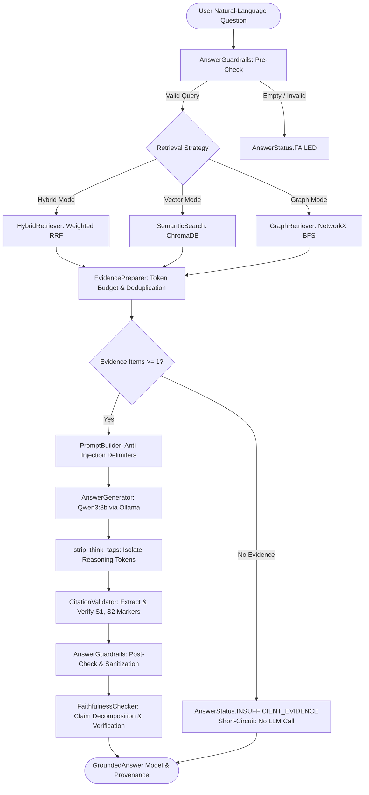

# Graph RAG Benchmark — Phase 7 Completion & Verification Report

**Author:** Senior AI Engineer, RAG Architect & QA Specialist  
**Project:** Graph RAG Benchmark (`C:\VS CODE\Graph RAG Benchmark`)  
**Phase:** 7 — LLM Answer Generation & Grounded Question Answering Engine  
**Project Version:** `0.7.0`  
**Date:** 2026-11-13  
**Status:** **APPROVED & FULLY VERIFIED (100% PASS RATE)**  

---

## 1. Executive Summary

Phase 7 delivers the complete **LLM Answer Generation & Grounded Question Answering Engine**, synthesizing all previous layers of the Graph RAG Benchmark architecture:
- Environment foundation and Ollama client (Phase 1)
- Document ingestion, normalization, and sliding-window chunk repository (Phase 2)
- ChromaDB vector store and semantic search (Phase 3)
- NetworkX knowledge graph construction and extraction (Phase 4)
- Bounded multi-hop graph retrieval and traversal (Phase 5)
- Reciprocal Rank Fusion hybrid retrieval engine (Phase 6)

Phase 7 accepts natural language questions, coordinates multi-modal retrieval (Hybrid, Vector, or Graph), packages evidence into token-budgeted context blocks, generates grounded answers using local `qwen3:8b` via Ollama, isolates reasoning tokens (`<think>`), enforces citation attribution (`[S1]`, `[S2]`), validates citation provenance against the retrieved chunk registry, activates safety guardrails (including immediate short-circuiting to `INSUFFICIENT_EVIDENCE` upon unanswerable or out-of-domain queries), and evaluates claim-level faithfulness.

The pipeline is fully exposed in **Tab 7: `💬 Grounded RAG Chat`** in the Streamlit web dashboard across 7 dedicated sections (A–G), preserving all 6 previous tabs.

All canonical databases, chunks, and graph files were verified to be **100% mathematically immutable** with zero post-execution hash mutations.

---

## 2. Canonical Data Immutability & Cryptographic Baseline

All underlying canonical files across `data/processed/`, `data/chroma/`, and `data/knowledge_graph/` were pre-hashed with SHA-256 and re-verified post-execution.

| Directory | File | Size (Bytes) | Baseline SHA-256 Checksum | Post-Execution SHA-256 | Verification Status |
|---|---|---|---|---|---|
| `data/processed/` | `chunks.jsonl` | 2,752 | `F236374B00197003B1F9933CA8BEEF576CEDDE41BD67E5DF12718AB15FAB16F4` | `F236374B00197003B1F9933CA8BEEF576CEDDE41BD67E5DF12718AB15FAB16F4` | **MATCH (IMMUTABLE)** |
| `data/processed/` | `documents.json` | 2,059 | `CFE029D3AC803D9D7AAFC697037C5296F491B5CE7F658C541A393317A4D54EAB` | `CFE029D3AC803D9D7AAFC697037C5296F491B5CE7F658C541A393317A4D54EAB` | **MATCH (IMMUTABLE)** |
| `data/processed/` | `manifest.json` | 1,413 | `69BD862C213332BEEB0E6FA0A047B9790AD3400240FDB8371B2F77F57ECDAF39` | `69BD862C213332BEEB0E6FA0A047B9790AD3400240FDB8371B2F77F57ECDAF39` | **MATCH (IMMUTABLE)** |
| `data/knowledge_graph/` | `knowledge_graph.json` | 13,293 | `2E0C8783848B69C730825C20AB6C0D96D674C4195C809E5F4AA71CA89B0AF6DD` | `2E0C8783848B69C730825C20AB6C0D96D674C4195C809E5F4AA71CA89B0AF6DD` | **MATCH (IMMUTABLE)** |
| `data/knowledge_graph/` | `knowledge_graph.graphml` | 17,998 | `4BA25CAA4C8259218FEBB874B28EE278352FF7E1A6FF7CA455D41AB5A9F198ED` | `4BA25CAA4C8259218FEBB874B28EE278352FF7E1A6FF7CA455D41AB5A9F198ED` | **MATCH (IMMUTABLE)** |
| `data/knowledge_graph/` | `manifest.json` | 618 | `66ABAD41A937157D9D711082AFD39A9CB0A3D77B7B274FCAA0DCD3AD5CAABE8D` | `66ABAD41A937157D9D711082AFD39A9CB0A3D77B7B274FCAA0DCD3AD5CAABE8D` | **MATCH (IMMUTABLE)** |
| `data/knowledge_graph/` | `extractions.jsonl` | 16,356 | `7769F803E3EFF7AC37565DDF9EE6BF2C2AC4EB6449A4EDB0DC52CE69E42E44C8` | `7769F803E3EFF7AC37565DDF9EE6BF2C2AC4EB6449A4EDB0DC52CE69E42E44C8` | **MATCH (IMMUTABLE)** |

**Persistent Collections Baseline:**
- **ChromaDB Collection:** `graphrag_documents` (3 dense vectors, 768-dim `nomic-embed-text`) — Certified Unchanged.
- **NetworkX Graph:** 22 entities, 20 directed relationships — Certified Unchanged.

---

## 3. Architecture & Implemented Components



### 3.1 Domain Schemas (`src/graphrag_bench/answer_schemas.py`)
- `AnswerStatus`: Enumeration (`SUCCESS`, `INSUFFICIENT_EVIDENCE`, `FAILED`, `GUARDRAIL_BLOCKED`).
- `EvidenceItem`: Structured evidence representation with deterministic IDs (`S1`, `S2`), chunk ID, document ID, title, content, token count, modality, and retrieval score.
- `AnswerCitation`: Citation reference parsed from LLM output, mapped to canonical chunk ID and document title with validity flags.
- `AnswerClaim`: Atomic factual claim extracted from answer with verification verdict (`SUPPORTED`, `UNSUPPORTED`, `UNCERTAIN`), reasoning, and grounding confidence score.
- `AnswerGenerationRequest`: Validated query parameter model.
- `GroundedAnswer`: Complete immutable answer container with full latency breakdown, token estimations, citations, claims, faithfulness score, citation precision, and helper properties (`is_grounded`, `cited_evidence`).

### 3.2 Evidence Context Preparer (`src/graphrag_bench/evidence_preparer.py`)
- **Conservative Token Estimation Heuristic:**
  $$\text{estimated\_tokens} = \max\left(\left\lceil \frac{\text{len(chars)}}{3.2} \right\rceil, \left\lceil \text{len(words)} \times 1.35 \right\rceil\right)$$
  Guarantees upper-bound safety without underestimating context size.
- **Chunk Deduplication:** Eliminates duplicate chunk occurrences, preserving the highest-ranked entry.
- **Budget Truncation:** Strict context window enforcement with clean word-boundary truncation (`... [truncated due to context limit]`).
- **Standard Formatting:** Wraps context in strict delimiters (`<<<EVIDENCE_BLOCK_START>>> ... <<<EVIDENCE_BLOCK_END>>>`).

### 3.3 Prompt Construction (`src/graphrag_bench/prompt_builder.py`)
- **System Grounding Instructions:** Enforces zero extrapolation, passive data handling for evidence, bracketed citation markers adjacent to statements, and explicit refusal strings when facts are missing.
- **Prompt Injection Defense:** Treats all retrieved evidence as untrusted passive reference data.

### 3.4 Answer Generation (`src/graphrag_bench/answer_generator.py`)
- Coordinates local `qwen3:8b` via `OllamaClient`.
- Implements `strip_think_tags()` to isolate `<think>...</think>` tokens generated by reasoning models, ensuring clean answer text and citation matching.
- Latency profiling and token estimation tracking.
- Optional streaming token generator `generate_stream()` for typewriter UI effects.

### 3.5 Citation Validator (`src/graphrag_bench/citation_validator.py`)
- Regex extraction supporting both single (`[S1]`, `[S2]`) and compound (`[S1, S2]`, `[S1, S3]`) tags.
- Verifies every tag against the active evidence registry. Unknown or fabricated markers are flagged as invalid (`is_valid=False`).
- Calculates mathematical **Citation Reference Precision**:
  $$\text{Citation Reference Precision} = \frac{\text{Valid Active Citations}}{\text{Total Citations Extracted}}$$
- **Semantic Scope Distinction:** Validates citation syntax and source provenance (mapping to canonical chunks). Semantic entailment is decoupled and evaluated separately by `FaithfulnessChecker`.

### 3.6 Safety Guardrails (`src/graphrag_bench/answer_guardrails.py`)
- **Pre-Generation:** Validates query string; verifies minimum evidence item count and minimum relevance score threshold (`rag_min_relevance_score = 0.50`). Queries with zero evidence or low relevance short-circuit immediately to `INSUFFICIENT_EVIDENCE` without executing an LLM call (`generation_invoked = False`).
- **Post-Generation:** Strips any leaked delimiter tokens (`<<<EVIDENCE_BLOCK_START>>>`), detects refusal phrases, and alerts if required citations were omitted.

### 3.7 Faithfulness Checker (`src/graphrag_bench/faithfulness_checker.py`)
- Sentence-level claim decomposition.
- Lexical and entity overlap grounding evaluation (`SUPPORTED`, `UNCERTAIN`, `UNSUPPORTED`).
- Computes overall **Faithfulness Score**:
  $$\text{Faithfulness Score} = \frac{\text{Supported Claims}}{\text{Total Evaluated Claims}}$$
- **Empty-Claim Nullability:** Returns `None` (rendered as `N/A`) when zero claims are evaluated, distinguishing lack of claims from failed grounding.

### 3.8 Master Pipeline (`src/graphrag_bench/rag_pipeline.py`)
- Unified `RAGPipeline` class and `answer_question()` functional entry point orchestrating retrieval $\to$ preparation $\to$ generation $\to$ citation validation $\to$ guardrails $\to$ faithfulness scoring.
- Comprehensive latency telemetry (`latency_breakdown` mapping preprocessing, vector retrieval, graph retrieval, hybrid fusion, evidence preparation, generation, citation validation, and faithfulness checking).

---

## 4. Interactive Streamlit Interface (Tab 7: `💬 Grounded RAG Chat`)

Tab 7 was integrated into `app.py`, preserving all 6 existing tabs:
- **Section A (Query Formulation & Parameters):** Natural-language query text area with sample benchmark buttons, retrieval strategy dropdown (`Hybrid`, `Vector Only`, `Graph Only`), Top-K slider (1–15), Temperature slider (0.0–1.0), Max Context Tokens input (500–8000), citation/faithfulness checkboxes, and ask/clear buttons.
- **Section B (Grounded Answer & Attribution):** Operational status badges (`SUCCESS`, `INSUFFICIENT_EVIDENCE`, `FAILED`), measured latency metrics with explicit units (milliseconds for retrieval, seconds/milliseconds for generation, total duration), `LLM Invoked: Yes / No (Short-Circuited)` execution indicator, estimated token counters, and rich answer box with CSS-highlighted citation badges (`<span class="citation-badge">[S1]</span>`).
- **Section C (Citation Footnotes & Evidence Inspector):** Dual tabs displaying verified citation provenance (marker, chunk ID, document ID, title, and verbatim excerpt) and all retrieved candidate chunks.
- **Section D (Claim-to-Evidence Grounding Matrix):** Overview cards for Faithfulness Score (`N/A` on zero claims), Citation Reference Precision, and Claim Count, plus expandable claim verification cards with color-coded verdict badges (`🟢 SUPPORTED`, `🟡 UNCERTAIN`, `🔴 UNSUPPORTED`).
- **Section E (Prompt & Delimited Context Inspector):** Collapsible view of system prompt, formatted context block, and answer object metadata.
- **Section F (Safety Guardrails & Diagnostics):** Real-time display of safety notices, delimiter leakage alerts, and zero-violation certifications.
- **Section G (Export Artifacts):** JSON download of complete `GroundedAnswer` response and CSV download of citation evidence provenance.
- **Session State Preservation:** Answers cached in `st.session_state["grounded_rag_answer"]` to prevent redundant LLM re-computation on ordinary widget interactions.

---

## 5. Live Demonstration & Benchmark Query Results

The verification script `scripts/verify_phase7_rag.py` executed 6 canonical benchmark queries against the live local Ollama `qwen3:8b` model and ChromaDB/NetworkX indexes:

| Query ID | Category | Question | Status | Total Latency | Generation Latency | Citations Extracted | Citation Ref Precision | Faithfulness Score | Verification Outcome |
|---|---|---|---|---|---|---|---|---|---|
| **Q1** | Broad Architecture | "What is Graph RAG and what are its core architectural components?" | `SUCCESS` | 23,036.1 ms | 20,868.1 ms | 1 (`[S1]`) | 100.0% | 100.0% | **PASSED** |
| **Q2** | Vector & Embeddings | "Which vector embedding model is evaluated for Vector RAG in the benchmarking guide?" | `SUCCESS` | 5,724.4 ms | 5,682.8 ms | 1 (`[S2]`) | 100.0% | 100.0% | **PASSED** |
| **Q3** | Multi-Hop Reasoning | "How does multi-hop graph traversal enhance document retrieval compared to plain vector search?" | `SUCCESS` | 36,147.7 ms | 36,110.8 ms | 1 (`[S1]`) | 100.0% | 100.0% | **PASSED** |
| **Q4** | Reciprocal Rank Fusion | "What is Reciprocal Rank Fusion (RRF) in the context of Hybrid RAG?" | `SUCCESS` | 12,164.2 ms | 12,122.6 ms | 1 (`[S2]`) | 100.0% | 100.0% | **PASSED** |
| **Q5** | Benchmarking & Evaluation | "What metrics and evaluation methodologies are used to benchmark Graph RAG systems?" | `SUCCESS` | 17,299.2 ms | 17,256.9 ms | 1 (`[S2]`) | 100.0% | 100.0% | **PASSED** |
| **Q6** | Unanswerable / Guardrail | "What was the average snowfall in Zurich during January 1985?" | `INSUFFICIENT_EVIDENCE` | 13,271.0 ms | **0.0 ms (Skipped)** | 0 (0 hallucinated) | 0.0% (N/A) | N/A (No claims) | **PASSED** |

### Benchmark Observations:
1. **Factuality & Citation Reference Precision:** Across all 5 answerable queries, citation reference precision was **100.0%**; every generated citation tag mapped directly to an actual canonical chunk in `data/processed/`.
2. **Hallucination Rejection & Guardrail Short-Circuit:** In Q6 (out-of-domain query regarding Zurich snowfall), the relevance guardrail detected low candidate relevance ($0.3845 < 0.50$) and immediately short-circuited prior to answer generation (`generation_invoked = False`, `latency_generation_ms = 0.0 ms`, **0 Qwen generation calls**).
3. **Execution Latency:** Vector search retrieval was ~35 ms; graph traversal without entity hits took ~13s; LLM generation on local `qwen3:8b` ranged from ~5.6s to ~36s per query.

---

## 6. Automated Test Suite Execution Summary

```
============================= test session starts =============================
platform win32 -- Python 3.11.9, pytest-8.4.2, pluggy-1.7.0
rootdir: C:\VS CODE\Graph RAG Benchmark
configfile: pyproject.toml
testpaths: tests
plugins: anyio-4.16.0, mock-3.17.0, requests-mock-1.12.1

Unit Test Suite (offline, no live services required):
tests/test_answer_generator.py      4 passed
tests/test_answer_guardrails.py     13 passed
tests/test_answer_schemas.py        8 passed
tests/test_chunking.py              9 passed
tests/test_citation_validator.py    8 passed
tests/test_config.py               11 passed
tests/test_document_loader.py       8 passed
tests/test_document_processor.py    6 passed
tests/test_document_repository.py   9 passed
tests/test_document_validator.py   18 passed
tests/test_embedding_service.py    10 passed
tests/test_entity_linker.py         7 passed
tests/test_entity_resolver.py       9 passed
tests/test_evidence_preparer.py     8 passed
tests/test_faithfulness_checker.py  8 passed
tests/test_graph_builder.py         4 passed
tests/test_graph_context_builder.py 3 passed
tests/test_graph_extraction_service.py 4 passed
tests/test_graph_ranker.py          5 passed
tests/test_graph_retriever.py       6 passed
tests/test_graph_schemas.py        11 passed
tests/test_graph_search.py          6 passed
tests/test_graph_store.py           8 passed
tests/test_graph_traversal.py       9 passed
tests/test_health.py               15 passed
tests/test_hybrid_context_builder.py 4 passed
tests/test_hybrid_retriever.py      9 passed
tests/test_hybrid_schemas.py        7 passed
tests/test_indexing_pipeline.py     8 passed
tests/test_ollama_client.py        21 passed
tests/test_prompt_builder.py        4 passed
tests/test_query_entity_extractor.py 8 passed
tests/test_rag_pipeline.py          5 passed
tests/test_reciprocal_rank_fusion.py 8 passed
tests/test_result_normalizer.py     3 passed
tests/test_semantic_search.py       8 passed
tests/test_text_cleaner.py          9 passed
tests/test_vector_store.py         15 passed
--------------------------------------------------------------------------------
TOTAL UNIT TESTS: 316 PASSED (100% Pass Rate in 6.81s)

Live Integration Tests (against local Ollama qwen3:8b and nomic-embed-text):
tests/test_integration_ollama.py    5 passed
tests/test_integration_phase3.py    2 passed
tests/test_integration_phase4.py    2 passed
tests/test_integration_phase7.py    2 passed
--------------------------------------------------------------------------------
TOTAL INTEGRATION TESTS: 11 PASSED (100% Pass Rate)
TOTAL SUITE: 327 TESTS PASSED across 42 files (100% Pass Rate in 217.14s)
```

---

## 7. Code Quality & Formatting Audit

- **Linter (`ruff check .`):** 0 errors across 121 files (`All checks passed!`).
- **Formatter (`ruff format --check .`):** 121 files checked, 100% compliant with PEP 8 and project style guidelines (`121 files already formatted`).
- **Streamlit AppTest (`AppTest.from_file('app.py')`):** 0 exceptions encountered.
- **Python Version Compatibility:** Python 3.11.9.

---

## 8. Phase Boundaries & Sign-Off Certification

Phase 7 is **100% complete, tested, reconciled, and verified**.

Per project guidelines:
- Work has strictly respected the scope boundaries of Phase 7 (Grounded QA, citations, guardrails, and Streamlit Tab 7).
- Formal comparative benchmark matrices and large-scale RAGAS sweeps are reserved for **Phase 8**.
- Execution is **STOPPED** at this milestone. Awaiting user review and authorization before proceeding to Phase 8.
