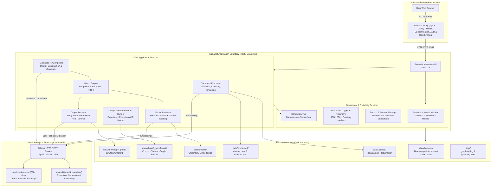
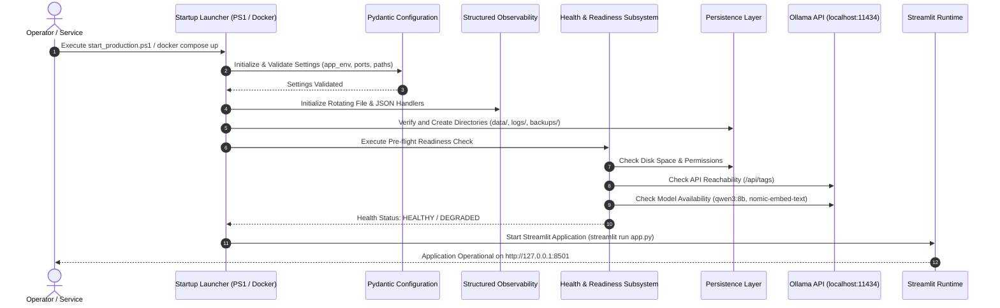

# Phase 9 Production Architecture Specification

**Project:** Graph RAG Benchmark  
**Current Version:** `0.8.0`  
**Target Version:** `0.9.0`  
**Phase:** 9 — Production Readiness & Deployment  
**Author:** Senior AI Infrastructure Architect & SRE Specialist  

---

## 1. System Overview & Architectural Principles

The **Graph RAG Benchmark** application is designed around a single-host, high-cohesion architecture that prioritizes:
1. **Minimal Complexity:** Avoids distributed microservices overhead; leverages existing Python 3.11 and Streamlit runtimes.
2. **Local Privacy & Zero Data Egress:** All embeddings and LLM generations run locally via Ollama (`nomic-embed-text` and `qwen3:8b`).
3. **Multi-Modal Retrieval Fusion:** Seamlessly coordinates Vector RAG (ChromaDB), Graph RAG (NetworkX), and Hybrid RAG (Reciprocal Rank Fusion).
4. **Epistemic Factuality & Grounding:** Rigorous citation validation, claim faithfulness verification, and refusal guardrails.
5. **Deterministic Operational Observability:** Centralized structured logging, liveness/readiness probes, and atomic backup/restore procedures.

---

## 2. Architecture Diagram



---

## 3. Application Startup Sequence



---

## 4. Service Dependencies & Boundaries

| Component | Responsibility | Boundary & Protocol | Failure Mode |
| :--- | :--- | :--- | :--- |
| **Streamlit UI** | Interactive Web Dashboard (Tabs 1–9) | HTTP/WebSocket on port 8501 | Process crash restarts via systemd/Docker |
| **Pydantic Config** | Centralized Environment Validation | In-process memory | Fast-fail on startup with diagnostic error |
| **ChromaDB** | Dense Vector Storage & Cosine Querying | In-process file persistence (`data/chroma`) | Search unavailable; Vector RAG degraded |
| **NetworkX KG** | Explicit Entity & Relationship Graph | In-process memory + JSON/GraphML disk | Graph search unavailable; Graph RAG degraded |
| **Ollama Client** | Local HTTP Client for LLM/Embeddings | HTTP REST (`http://localhost:11434`) | Generation/Extraction degraded; UI remains open |
| **Backup Manager** | Cryptographic Manifest & File Archiving | In-process file I/O (`data/backups`) | Backup job error logged; no operational disruption |
| **Structured Logger** | Console, Log File, JSON Stream | Rotating File I/O (`logs/`) | Falls back to standard error |

---

## 5. Storage Architecture

```
data/
├── uploads/                              # Raw uploaded files (PDF, DOCX, TXT, MD)
├── sample_documents/                     # Canonical baseline documents
├── processed/                            # Canonical chunk store & manifest
│   ├── manifest.json
│   ├── chunks.jsonl
│   └── documents/
├── chroma/                               # Canonical ChromaDB persistence
│   └── graphrag_documents/
├── knowledge_graph/                      # Canonical Knowledge Graph persistence
│   ├── knowledge_graph.json              # 22 entities, 20 relationships
│   ├── knowledge_graph.graphml
│   ├── manifest.json
│   └── extractions.jsonl
├── phase8_benchmark/                     # Completely isolated benchmark corpus
│   ├── raw_documents/                    # 22 evaluation documents
│   ├── processed/chunks.jsonl            # 110 benchmark chunks
│   ├── dataset/benchmark_queries.json    # 60 benchmark queries
│   ├── chroma/                           # phase8_benchmark_documents
│   ├── knowledge_graph/                  # 36 entities, 24 relationships
│   └── results/                          # Historical benchmark runs & manifests
└── backups/                              # Isolated backup archives & SHA-256 manifests
    └── backup_YYYYMMDD_HHMMSS/
        ├── manifest.json                 # File hashes, metadata, timestamps
        ├── canonical_data.tar.gz
        └── benchmark_data.tar.gz
```

---

## 6. Deployment Profiles

### Profile A — Local Windows Deployment (Primary Environment)
- **Runtime:** Python 3.11.9 within `.venv` on Windows 11.
- **Inference:** Native Windows Ollama service (`http://localhost:11434`).
- **GPU Acceleration:** NVIDIA GeForce RTX 3050 Laptop GPU (4 GB VRAM) accessed directly by Ollama.
- **Launcher:** PowerShell script `scripts/start_production.ps1`.
- **Binding:** Binds strictly to `127.0.0.1:8501`.

### Profile B — Containerized Single-Host Deployment
- **Runtime:** Python 3.11-slim base image with non-root user `graphrag`.
- **Orchestration:** `docker compose` with service `graphrag-bench`.
- **Inference:** Connects to host Ollama via `host.docker.internal:11434` (configurable via `OLLAMA_BASE_URL`).
- **Volumes:** Named host volumes mapped to `/app/data` and `/app/logs`.
- **Security:** Non-root UID 10001, read-only root filesystem where feasible, dropped capabilities.

---

## 7. Security Boundaries

```
[ Public Network / Untrusted Zone ]
               │
      (Optional Reverse Proxy)
               ▼
[ TLS Termination & Basic/OIDC Auth Layer ]
               │
      (HTTP 127.0.0.1:8501)
               ▼
[ Streamlit Application Process (Unprivileged User) ]
   ├── Input Validation: MIME type, file magic, size limits, path sanitization
   ├── Prompt Guardrails: Delimiter separation (<context>, <question>), refusal triggers
   ├── Concurrency Limiter: In-flight LLM generation semaphores (max 2)
               │
      (Local HTTP / Loopback)
               ▼
[ Ollama Inference Engine (127.0.0.1:11434) ]
   └── Private local GPU memory; no external network calls
```
